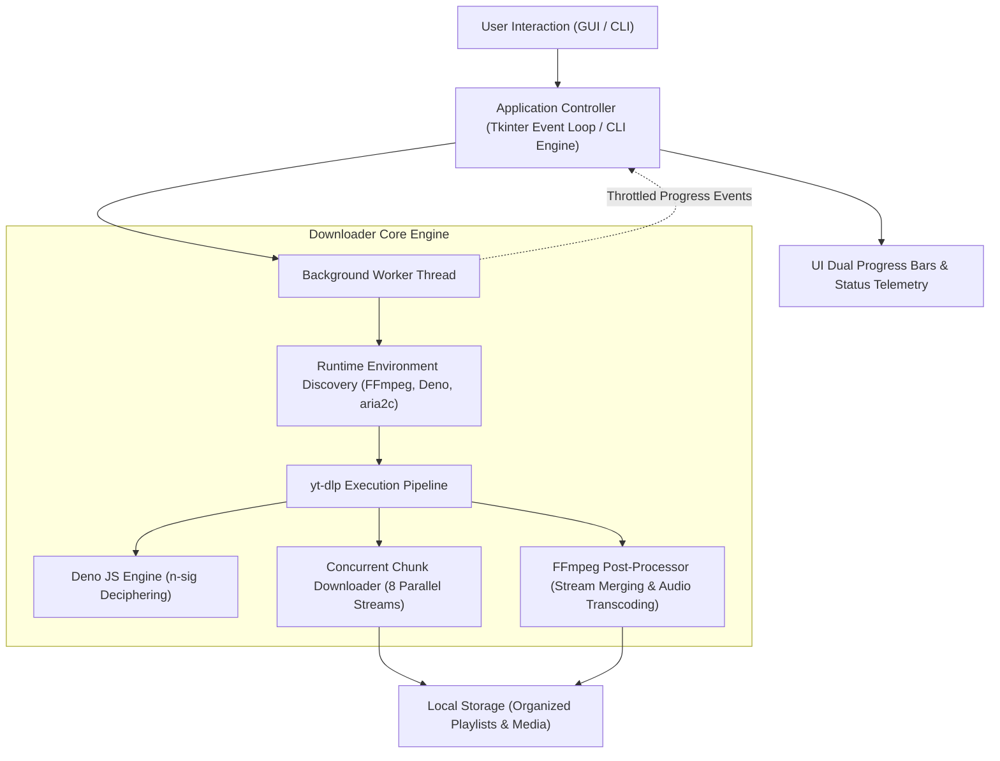

<p align="center">
  
</p>

# YouTube Media & Playlist Downloader Pro

[](https://www.python.org/)
[](https://github.com/TomSchimansky/CustomTkinter)
[](https://github.com/yt-dlp/yt-dlp)
[](https://ffmpeg.org/)
[](https://deno.land/)
[](LICENSE)

A high-performance, asynchronous desktop GUI and CLI application for downloading YouTube videos, audio tracks, and full playlists. Engineered with multi-stream parallel fragment downloads, automatic JavaScript `n-sig` extraction acceleration, resilient error recovery, and responsive UI threading.

---

## Architecture Overview



---

## Key Features

- **Asynchronous GUI & CLI**: Built on CustomTkinter with multi-threaded background workers, keeping the interface completely responsive during heavy downloads.
- **32x Multi-Stream Parallel Acceleration**: Employs a 32-connection parallel chunk streaming architecture (leveraging `aria2c` and multi-fragment streaming) for maximum line-rate saturation and download throughput.
- **Throttling Bypass & High Speed**: Automatically detects and leverages Deno runtime to solve YouTube client-side JavaScript challenges (`n-sig`), eliminating bandwidth throttling.
- **Full Playlist Management**:
  - Automatically identifies playlists and item counts.
  - Automatically organizes videos into dedicated subdirectories with clean numerical prefixes (`01 - Title.mp4`).
  - Dual progress tracking: overall playlist completion vs. active item download status.
  - Fault-tolerant batch processing: skips deleted/private videos without stopping the queue.
- **Instant Non-Blocking Cancellation**: Native interruption handling via `DownloadCancelled` signal with automatic purging of orphan `.part` and `.ytdl` files.
- **Adaptive Stream Merging**: Automatically invokes FFmpeg to merge high-resolution adaptive video streams (1080p, 2K, 4K) and audio, or transcode into clean 192kbps MP3 / M4A files.
- **Clean Telemetry**: Sanitizes raw ANSI terminal escape sequences to present crisp progress percentages, transfer speeds, and ETAs.

---

## Tech Stack

| Component | Technology | Description |
| :--- | :--- | :--- |
| **Language** | Python 3.10+ | Core application logic and multi-threading |
| **Graphical Interface** | CustomTkinter | Modern dark/light adaptive desktop UI |
| **Media Extraction** | yt-dlp | YouTube extraction pipeline and protocol handling |
| **Media Processing** | FFmpeg | Video container muxing and audio transcoding |
| **JS Runtime** | Deno | High-speed JavaScript engine for signature deciphering |
| **Image Processing** | Pillow (PIL) | Asynchronous video thumbnail rendering |

---

## Installation & Setup

### Prerequisites

1. **Python 3.10+**: Ensure Python is installed and added to your system `PATH`.
2. **FFmpeg & Deno** (Optional for basic downloads, recommended for full HD/4K & high speeds):
   - Windows (via WinGet):
     ```powershell
     winget install Gyan.FFmpeg.Essentials
     winget install DenoLand.Deno
     ```
   - macOS (via Homebrew):
     ```bash
     brew install ffmpeg deno
     ```
   - Linux (via APT):
     ```bash
     sudo apt update && sudo apt install ffmpeg
     curl -fsSL https://deno.land/install.sh | sh
     ```

### 1. Clone Repository

```bash
git clone https://github.com/farisemad3030-sudo/youtube-downloader-pro.git
cd youtube-downloader-pro
```

### 2. Install Dependencies

```bash
pip install -r requirements.txt
```

---

## Usage Guide

### Desktop GUI Mode

Launch the graphical user interface:

```bash
python app.py
```

1. Paste any YouTube video or playlist link into the URL input field.
2. Click **Fetch** to retrieve metadata (title, channel, duration, and thumbnail preview).
3. Select your desired quality format from the dropdown (*Best Quality*, *1080p*, *720p*, *MP3 Audio*, etc.).
4. Choose the destination directory (defaults to your user `Downloads` folder).
5. Click **Download Now**. Use **Cancel** anytime to stop and clean up partial files immediately.

### Command-Line Interface (CLI) Mode

Run interactive prompts:

```bash
python cli.py
```

Or pass arguments directly:

```bash
# Download a single video in 1080p
python cli.py "https://www.youtube.com/watch?v=EXAMPLE" -f "1080p (Full HD)"

# Download an entire playlist to a custom folder
python cli.py "https://www.youtube.com/playlist?list=EXAMPLE" --playlist -o "D:/Media/Courses"

# Extract audio only in MP3
python cli.py "https://www.youtube.com/watch?v=EXAMPLE" -f "Audio Only (MP3)"
```

---

## Author & Contact

**Faris Emad Al-Yamani**
- **Email**: [farisemad2019@gmail.com](mailto:farisemad2019@gmail.com)
- **LinkedIn**: [linkedin.com/in/faris-emad-2a852536a](https://www.linkedin.com/in/faris-emad-2a852536a)
- **GitHub**: [@farisemad3030-sudo](https://github.com/farisemad3030-sudo)

---

## License

This project is licensed under the [MIT License](LICENSE).
